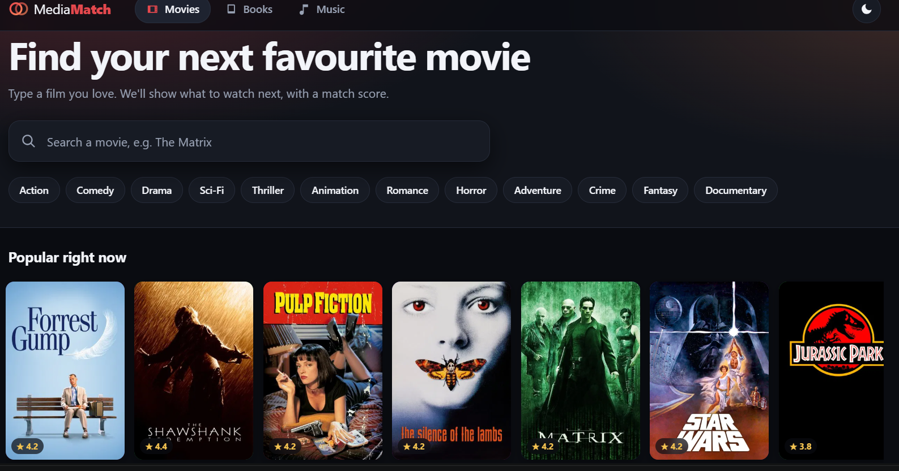
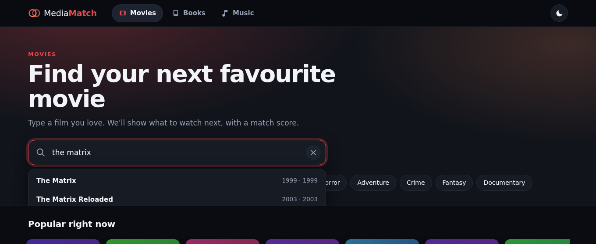
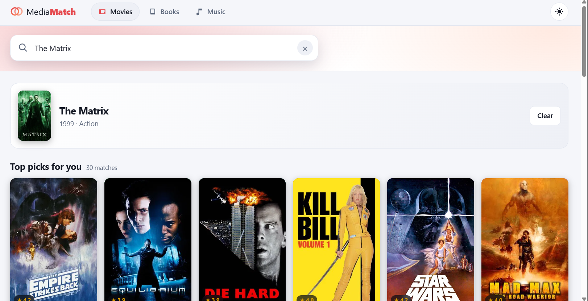
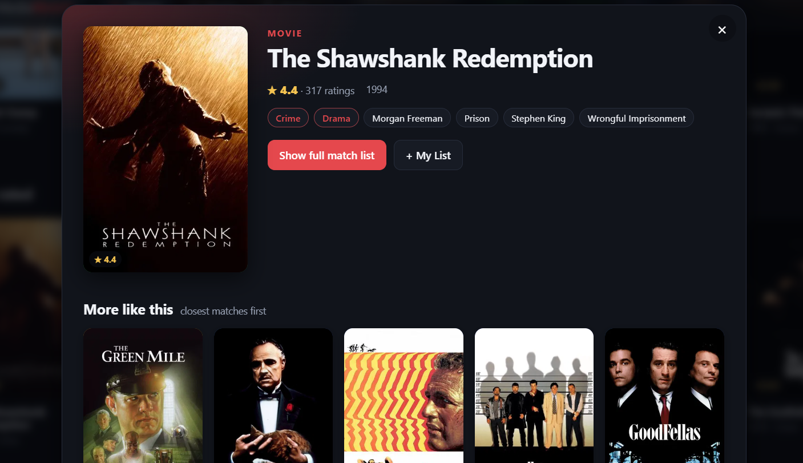

# MediaMatch · AI-based movie, book & music recommender

A Netflix-style web app. Pick **Movies**, **Books** or **Music**, type one title you like, and get similar
titles with a **match percentage** and a one-line reason. Dark theme by default, with a light-theme toggle.

Built on real data (MovieLens, Goodbooks-10k, Spotify Tracks) with a **Flask** API, a hybrid
recommender (scikit-learn / SciPy) and a dependency-free **vanilla JS** frontend.



| Search with autocomplete | Match results | Detail view |
| --- | --- | --- |
|  |  |  |

## Features

- **Three tabs** (Movies / Books / Music). Each has its own catalogue, genre chips and home rows.
- **Search by title** with live autocomplete (arrow keys + Enter). Press `/` to focus the search box.
- **Match %, plus why**: "Viewers of *Toy Story* also liked this · Shares Animation, Children".
- **Covers**: movie posters (TMDB), book covers (Goodreads, Open Library fallback), album art (Deezer / iTunes). Lazy-loaded and cached, with a generated gradient card if none is found.
- **Detail view**: ratings, genres, tags; for songs, tempo, duration and audio-feature meters.
- **My List** (heart any title, kept in your browser) with a "Picked from your list" row of recommendations built from everything you saved.
- **Dark / light theme**, responsive layout, keyboard friendly.
- **Offline evaluation** script and an in-app results page.

## Quick start

```bash
pip install -r requirements.txt
# put the datasets in data/ (see data/README.md)
python backend/app.py            # builds the indexes (~10 s), then http://127.0.0.1:5000
```

Options: `--port 8000`, `--host 0.0.0.0`.

**Movie posters** need a free TMDB API key. Create one at themoviedb.org, then:

```bash
cp backend/.env.example backend/.env     # and paste your key after TMDB_API_KEY=
```

Without a key everything still works; movies just show gradient cards. Book covers and album art need no key.
Cover lookups need internet access from the machine running the server.

## How the recommendations work

For a seed title (or several, for My List), every other item in the same tab gets a score:

| Signal | Movies | Books | Music |
| --- | --- | --- | --- |
| **Content similarity** (TF-IDF + cosine) | genres, user tags, decade | popular shelf tags (junk shelves filtered), authors | 9 audio features (z-scored) + genre |
| **Collaborative similarity** | item-item adjusted cosine on 100k ratings | same, on ~1M ratings | none (no user data) |
| **Popularity prior** | small | small | larger, so you get songs people know |

- The collaborative part is **shrunk by the number of co-raters** and only trusted for items with enough ratings (full weight at 20+, reduced at 5+, none below).
  Cold or niche items fall back to content only.
- Candidates with very few ratings are down-weighted, and music results are capped at 2 tracks per artist for variety.
- **Match %** is the blended score relative to the best candidate (about 99% for the top result). It tells you how close a title is *compared with the other candidates*; it is **not** a prediction of how much you'll like it.
- Each tab recommends within its own type. The three datasets come from different users, so cross-media recommendations aren't possible.

## Data

| Tab | Dataset | Size after cleaning |
| --- | --- | --- |
| Movies | MovieLens `ml-latest-small` | 9,742 movies, 100,836 ratings, 610 users |
| Books | Goodbooks-10k | 10,000 books, 981,756 ratings, 53,424 users |
| Music | Spotify Tracks Dataset (Kaggle) | 114,000 rows, de-duplicated to 81,206 unique songs (many tracks were listed under several genres) |

Cleaning highlights: movie titles like "Matrix, The (1999)" become "The Matrix" with a separate year; Goodreads series
suffixes are stripped; non-genre shelves ("to-read", "favorites", …) are removed from book tags; duplicate songs are merged and their genres combined.
See [`data/README.md`](data/README.md) for download links and licences.

## Evaluation

`python backend/evaluate.py` runs a **leave-one-out** test on 250 random users per dataset: hide one item the user liked (rating ≥ 4),
build the model without it, give the model up to 10 of the user's other liked items, and check whether the hidden item shows up in the top 10.

| Domain | Model | HitRate@10 | NDCG@10 | MRR | Coverage@10 |
| --- | --- | --- | --- | --- | --- |
| Movies | Popularity | 0.120 | 0.066 | 0.060 | 0.009 |
| Movies | Content only | 0.012 | 0.011 | 0.012 | 0.061 |
| Movies | Collaborative only | **0.164** | **0.083** | **0.068** | 0.052 |
| Movies | Hybrid (used in the app) | 0.072 | 0.044 | 0.042 | 0.062 |
| Books | Popularity | 0.004 | 0.002 | 0.001 | 0.001 |
| Books | Content only | 0.144 | 0.079 | 0.066 | 0.171 |
| Books | Collaborative only | **0.220** | **0.143** | **0.126** | 0.204 |
| Books | Hybrid (used in the app) | 0.164 | 0.116 | 0.110 | 0.189 |

How to read this honestly:

- **Collaborative-only wins this particular test.** The test rewards "what will this user rate highly next", which is exactly what ratings capture.
  The hybrid sits between collaborative and content-only, because it mixes in content similarity, which is weak at that task, especially on movies where only genres and a few tags are available.
- **Popularity is a strong baseline on small MovieLens** (it beats the hybrid and content-only there) and useless on books, where ratings are spread across 10,000 popular titles.
- The hybrid's reason to exist is what this test does not measure: it works for **cold or rarely rated titles**, produces **explanations**, covers far more of the catalogue than popularity (movies: 6.2% vs 0.9%), and it is the only option for **music**, which has no ratings at all.
- With 250 users per row, expect roughly ±2 percentage points of noise on HitRate. Music isn't evaluated because the dataset has no user data.
- I tried a candidate-confidence penalty and larger popularity weights; neither moved these numbers meaningfully, so the defaults stayed.

Obvious next step if you want the in-app engine to score higher on this metric: weight the collaborative signal more heavily for items with many ratings, or train a matrix-factorisation model (as in `legacy/`) on the MovieLens and Goodbooks ratings and blend its scores in.

## REST API

| Method | Endpoint | Description |
| --- | --- | --- |
| GET | `/api/meta` | Item counts, genre chips, whether TMDB is configured |
| GET | `/api/<domain>/home` | Home rows (popular, top rated, genre rows) |
| GET | `/api/<domain>/search?q=` | Autocomplete (prefix and word matches first, then popularity) |
| GET | `/api/<domain>/similar/<id>?n=24` | Seed details + matches with `match` and `why` |
| POST | `/api/<domain>/for_list` | `{"ids": [1, 2, 3]}` → recommendations from several seeds |
| GET | `/api/<domain>/browse?genre=&sort=popular\|top&offset=` | Paged genre browsing |
| GET | `/api/<domain>/item/<id>` · `/items?ids=1,2` | Item detail · cards by id |
| GET | `/api/<domain>/cover/<id>` | Resolves and caches a poster or album cover |
| GET | `/api/results` | Evaluation table (`backend/results.csv`) |

`<domain>` is `movies`, `books` or `music`.

```bash
curl "http://127.0.0.1:5000/api/books/search?q=hunger"
curl "http://127.0.0.1:5000/api/books/similar/0?n=5"
```

## Project layout

```
backend/
  app.py          Flask app: REST API + serves the frontend
  data_loader.py  cleans the 3 datasets into one common structure
  engine.py       hybrid recommender, search, browse, home rows
  covers.py       TMDB / Deezer / iTunes cover lookup with an on-disk cache
  evaluate.py     leave-one-out evaluation, writes results.csv
  test_api.py     16 tests (fixtures in the real file formats; network mocked)
frontend/         index.html · static/style.css · static/app.js
data/             put the datasets here (not committed)
legacy/           the first prototype on synthetic data (matrix factorisation + metrics)
```

## Tests

```bash
cd backend
python -m pytest -q        # or: python test_api.py
```

The tests build tiny fixture datasets with the same schema as the real files, so they run in seconds without the downloads.
The cover-lookup tests mock the network.

## Limitations

- **Similarity, not taste prediction.** There are no user accounts or personal ratings; "My List" is the only personalisation, and it's stored locally in your browser.
- **Small movie data.** `ml-latest-small` has only 3,650 movies with 5+ ratings. Use the larger MovieLens sets for better collaborative signals.
- **Music is content-only**, so recommendations follow sound and genre, not listening behaviour.
- **Cover matching for songs goes by name**, so an occasional song may get a wrong cover or none.
- Flask's built-in server is for development. For deployment use gunicorn or waitress.

## Credits

MovieLens (GroupLens Research) · Goodbooks-10k (Zygmunt Zając) · Spotify Tracks Dataset (Kaggle) ·
Movie posters: this product uses the TMDB API but is not endorsed or certified by TMDB · Album art: Deezer and iTunes Search APIs · Book covers: Goodreads and Open Library.
